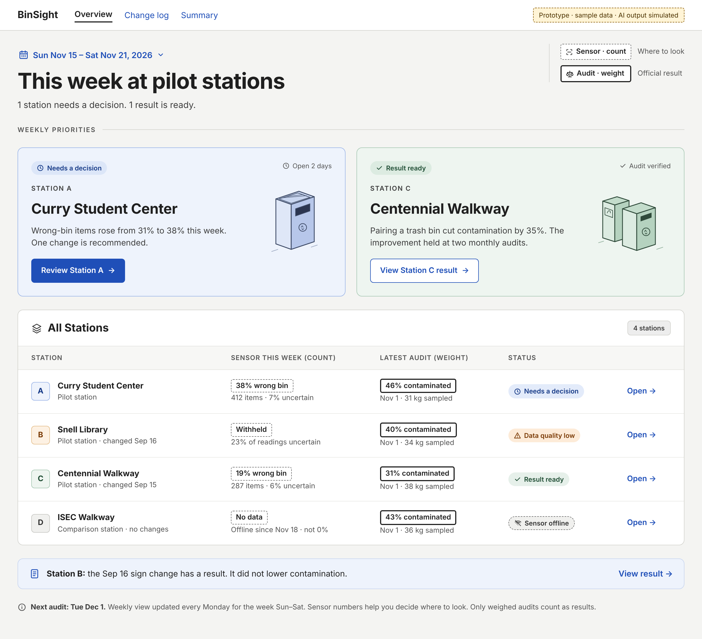
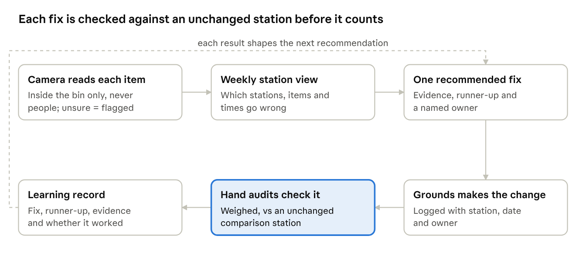

# BinSight — Campus Recycling Prototype

**Find which outdoor bins get contaminated, try one fix, and prove whether it worked — in weeks, not at the yearly audit.**

BinSight is a product concept for campus recycling. This repository holds the clickable prototype, its screenshots, a walkthrough PDF and the full product understanding document.

**▶ Live prototype: https://binsightneu.netlify.app** — best viewed on a laptop.



> **Status:** concept / prototype. All data is sample data. There is no backend and no real AI — the screens simulate what a pilot would show.

---

## Contents

- [The product in 30 seconds](#the-product-in-30-seconds)
- [Run the prototype](#run-the-prototype)
- [Screen map](#screen-map)
- [The test scenario](#the-test-scenario)
- [Product rules the screens follow](#product-rules-the-screens-follow)
- [What the prototype tests](#what-the-prototype-tests)
- [Repository structure](#repository-structure)
- [How the screens are built](#how-the-screens-are-built)
- [Known gaps and open questions](#known-gaps-and-open-questions)
- [Next steps in VS Code](#next-steps-in-vs-code)

---

## The product in 30 seconds

| | |
| --- | --- |
| **Problem** | Public bins make the wrong choice the easiest one, and the university only learns about contamination from one audit a year or a rejected load — too late, and with no link to a station, item or time. |
| **Main user and customer** | The campus Materials and Recycling lead (persona: **Marcus**). |
| **Affected user** | Students and visitors at the bin (persona: **Maya**). She does nothing new — no app, no scan, no screen. |
| **How it works** | A small camera module clips inside existing bins and records *what* goes in, never *who*. Each week Marcus sees a station-by-station view, **one recommended fix** with evidence and an owner, and a fair before-and-after check against an unchanged comparison station. |
| **Business model** | Paid one-semester pilot, then a yearly fee per station (hardware, maintenance, updates included). |
| **Success (North Star)** | Recycling Correct-Sort Rate from weighed hand audits. Pilot target: contamination at changed stations falls **≥30% below their own baseline** and beats the comparison station, without pushing recyclables into the trash. |

**The weekly loop:** sense → show where it goes wrong → recommend one fix → make it → prove it with hand audits → learn for next time.



Full detail: [docs/product-understanding.md](docs/product-understanding.md).

---

## Run the prototype

**Online:** https://binsightneu.netlify.app (auto-updates when `main` changes).

**Locally:** The screens are plain HTML files. Each one loads `prototype/support.js`, a small renderer, so no build step is needed.

**Option A — VS Code Live Server (easiest)**
1. Open this folder in VS Code and install the recommended **Live Server** extension when prompted.
2. Right-click `prototype/index.html` → **Open with Live Server**.

**Option B — Node**
```bash
npm start          # serves /prototype at http://localhost:5173
```

**Option C — Python**
```bash
cd prototype
python3 -m http.server 5173
# open http://localhost:5173
```

You can also double-click any `.dc.html` file to open it directly; a local server is still recommended so links behave the same as on a real site.

Start at **`prototype/index.html`** — it lists every screen.

---

## Screen map

Main navigation on Marcus's screens: **Overview · Change log · Summary**.

### Main path — from finding to proof

| # | Screen | File | Question it answers | Screenshot |
| --- | --- | --- | --- | --- |
| 1 | Overview | [`Main.dc.html`](prototype/Main.dc.html) | What needs me this week? | [view](docs/screens/01_overview.png) · [week picker](docs/screens/02_overview_picker.png) |
| 2 | Station detail (A) | [`StationDetail.dc.html`](prototype/StationDetail.dc.html) | What is going wrong here? | [view](docs/screens/03_station_a.png) |
| 3 | Recommendation | [`Recommendation.dc.html`](prototype/Recommendation.dc.html) | What should I do, and why? | [view](docs/screens/04_rec.png) · [disagree](docs/screens/05_rec_disagree.png) · [can't be done](docs/screens/06_rec_cant.png) |
| 4 | Change log | [`LogChange.dc.html`](prototype/LogChange.dc.html) | Record what I did | [form](docs/screens/07_log_form.png) · [future date error](docs/screens/08_log_error.png) · [overlap warning](docs/screens/09_log_warn.png) · [logged](docs/screens/10_log_done.png) |
| 5 | Result — improved (C) | [`ResultImproved.dc.html`](prototype/ResultImproved.dc.html) | Did my fix work? | [view](docs/screens/11_result_c.png) |
| 6 | Summary (monthly report) | [`Summary.dc.html`](prototype/Summary.dc.html) | What goes in this month's report to the University Waste Management Office team? | [view](docs/screens/12_summary.png) · [cost requested](docs/screens/13_summary_req.png) |

### When something goes wrong

| Screen | File | What it shows | Screenshot |
| --- | --- | --- | --- |
| Low confidence (B) | [`LowConfidence.dc.html`](prototype/LowConfidence.dc.html) | Sensor unsure on >15% of items → numbers hidden, no recommendation | [view](docs/screens/14_lowconf.png) · [check requested](docs/screens/15_lowconf_req.png) |
| Station offline (D) | [`Offline.dc.html`](prototype/Offline.dc.html) | "No data", never 0%; 7 days stored on the module | [view](docs/screens/16_offline.png) |
| Result — no real change (B) | [`ResultNoChange.dc.html`](prototype/ResultNoChange.dc.html) | −2% vs −4% → "no real change"; suggests a different type of fix | [view](docs/screens/17_result_b.png) |

### Off Marcus's path

| Screen | File | Who it's for | Screenshot |
| --- | --- | --- | --- |
| Install check | [`InstallCheck.dc.html`](prototype/InstallCheck.dc.html) | Installers: camera sees only the bin | [fault](docs/screens/18_install_fault.png) · [pass](docs/screens/19_install_pass.png) |
| Hardware module | [`HardwareModule.dc.html`](prototype/HardwareModule.dc.html) | Stakeholders reviewing the device | [view](docs/screens/20_hardware.png) |
| Station notice | [`StationNotice.dc.html`](prototype/StationNotice.dc.html) | People at the bin | [view](docs/screens/21_notice.png) |

A full walkthrough with notes on every state: [docs/BinSight-Prototype-Journey-Slides.pdf](docs/BinSight-Prototype-Journey-Slides.pdf).

---

## The test scenario

- **Today:** Mon Nov 23, 2026. **Latest week:** Sun Nov 15 – Sat Nov 21 (week 10 of a 15-week pilot).
- **Hand audits:** Sep 1 (baseline), Oct 1, Nov 1. **Next audit:** Tue Dec 1.

| Station | Role | Story |
| --- | --- | --- |
| **A · Curry Student Center** | Pilot (Big Belly) | Needs a decision this week |
| **B · Snell Library** | Pilot | Sign added Sep 16; sensor data quality low; no real change (−2% vs −4%) |
| **C · Centennial Walkway** | Pilot | Trash bin paired Sep 15; audits 48% → 33% → 31% vs D 45% → 44% → 43% (−35%) |
| **D · ISEC Walkway** | Comparison (unchanged) | Offline since Wed Nov 18 |

**Suggested test tasks for a session (about 15 minutes):**
1. "What needs your attention this week?" (Overview)
2. "Decide what to do at Curry Student Center." (Station detail → Recommendation)
3. "Record that the change was made today." (Change log — try a future date too)
4. "Did the change at Centennial Walkway work? How sure are you?" (Result)
5. "What will this month's report tell the University Waste Management Office team?" (Summary)
6. "What's happening at Snell Library and ISEC Walkway?" (edge cases)

---

## Product rules the screens follow

- **Two kinds of numbers, always labelled.** *Sensor* (dashed border) = item counts from the camera, a hint about where to look. *Audit* (solid border) = weighed by hand, the official result. Never mixed in one figure.
- **Missing data is "No data", never 0%.**
- **One recommended fix at a time**, always with its evidence (each line has a source), a runner-up and a named owner. Marcus can accept, disagree (and say why) or mark it "can't be done".
- **Fair comparison.** Results are judged against an unchanged comparison station, with a guardrail: recyclables in the trash must not go up.
- **Low trust → no advice.** If more than 15% of readings are uncertain, sensor numbers are hidden and no recommendation is made.
- **Schedule.** Weeks run Sunday–Saturday; Marcus's weekly view updates every Monday. Hand audits run on the 1st of each month.
- **Reports are monthly (for now).** One report per month, generated on the 1st and sent to the **University Waste Management Office team**. There is no weekly report.
- **Privacy.** The camera sees only inside the bin; raw images are deleted within 7 days; only item records leave the module.

---

## What the prototype tests

> *We are building this prototype to determine whether a campus recycling lead can go from a station-level contamination finding to choosing one fix and judging whether it worked, when the data shows uncertainty and gaps.*

It tests usability, trust, workflow fit and value with real stakeholders. It does **not** test sensing accuracy — that is the pilot's job.

---

## Repository structure

```
binsight-prototype/
├── README.md                         ← you are here
├── package.json                      ← `npm start` serves the prototype
├── prototype/
│   ├── index.html                    ← start page: links to all 12 screens
│   ├── support.js                    ← tiny renderer that makes .dc.html files run in a browser
│   ├── Main.dc.html                  ← 1  Overview
│   ├── StationDetail.dc.html         ← 2  Station detail (A)
│   ├── Recommendation.dc.html        ← 3  Recommendation
│   ├── LogChange.dc.html             ← 4  Change log
│   ├── ResultImproved.dc.html        ← 5  Result — improved (C)
│   ├── Summary.dc.html               ← 6  Monthly report
│   ├── LowConfidence.dc.html         ← E1 Low confidence (B)
│   ├── Offline.dc.html               ← E2 Offline (D)
│   ├── ResultNoChange.dc.html        ← E3 No real change (B)
│   ├── InstallCheck.dc.html          ← S1 Installer tool
│   ├── HardwareModule.dc.html        ← S2 Device
│   └── StationNotice.dc.html         ← S3 Notice at the bin
├── docs/
│   ├── product-understanding.md      ← full product write-up (current)
│   ├── BinSight-Prototype-Journey-Slides.pdf ← 23-slide walkthrough
│   ├── images/                       ← weekly loop + roadmap diagrams
│   └── screens/                      ← 21 screenshots, one per state
├── prompts/
│   └── ai-builder-prompt.md          ← prompt to rebuild this in v0 / Bolt / Lovable / React
├── tools/                            ← optional Python scripts (Playwright)
│   ├── render_screens.py             ← re-capture all screenshots
│   ├── build_slides.py               ← build the walkthrough slides HTML
│   └── slides_to_pdf.py              ← print the slides to PDF
└── .vscode/                          ← recommended extensions + Live Server root
```

---

## How the screens are built

Each `.dc.html` file is a self-contained screen: HTML markup with `{{placeholders}}`, `<sc-if>` / `<sc-for>` blocks for conditions and lists, and a small `class Component extends DCLogic` script that holds the screen's state (for example, which week is picked or whether a form was submitted). `support.js` reads that markup and renders it in the browser — no framework, no build.

To change a screen, edit its `.dc.html` file and refresh the browser.

**Re-capturing screenshots (optional):**
```bash
pip install playwright && python -m playwright install chromium
python tools/render_screens.py      # writes docs/screens/*.png
python tools/build_slides.py        # writes tools/slides.html
python tools/slides_to_pdf.py       # writes docs/BinSight-Prototype-Journey-Slides.pdf
```

---

## Known gaps and open questions

Things to fix or decide before user testing:

- **Offline screen button says "Ask Grounds to check the station."** The PRD routes hardware faults to the BinSight team, not Grounds. Decide which is right and change one of them.
- **Audit schedule conflict.** The prototype uses monthly audits on the 1st; the PRD says baseline / mid-pilot / end. A Jan 1 audit would fall in winter break. Pick one schedule and update the other.
- **Only the Overview has the newer visual style.** The other screens still use the earlier layout.
- **Not responsive.** Built for a 1280 px desktop window.
- **No real export.** "Download PDF" on the Summary is simulated.

Open product questions:
- Who holds the budget for outdoor stations — Materials and Recycling or Grounds?
- How long to wait before judging a change (PRD Q-10)?
- Real module size, weight and power source.
- Should the camera pause automatically during bag changes?
- What is the real baseline contamination rate at the pilot stations?

---

## Next steps in VS Code

1. **Unify the look.** Bring Station detail, Recommendation, Change log, Result and Summary up to the new Overview style (tinted cards, letter badges, status pills with icons).
2. **Resolve the two conflicts above** (Offline button owner, audit schedule) so the prototype and PRD agree.
3. **Add a "back to all screens" link** on each screen for easier testing.
4. **Optional rebuild in React.** Use [`prompts/ai-builder-prompt.md`](prompts/ai-builder-prompt.md) as the spec. Keep the sample data in one file so test scenarios are easy to change.
5. **Deploy a test link.** GitHub Pages: Settings → Pages → Deploy from branch → `main` / `(root)`. The prototype will be at `https://<your-username>.github.io/<repo-name>/prototype/`. Or drag the `prototype` folder into Netlify Drop.

---

## Note

Sample data only. Not affiliated with or endorsed by Northeastern University.
