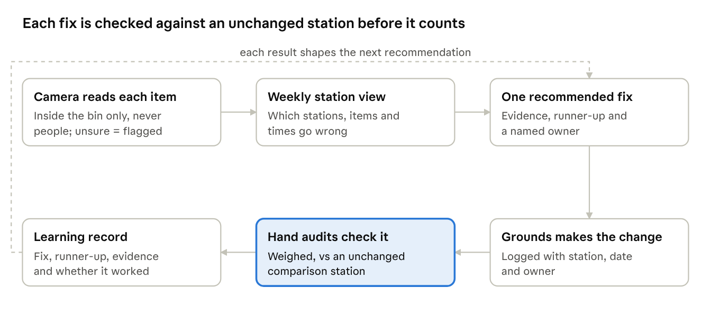
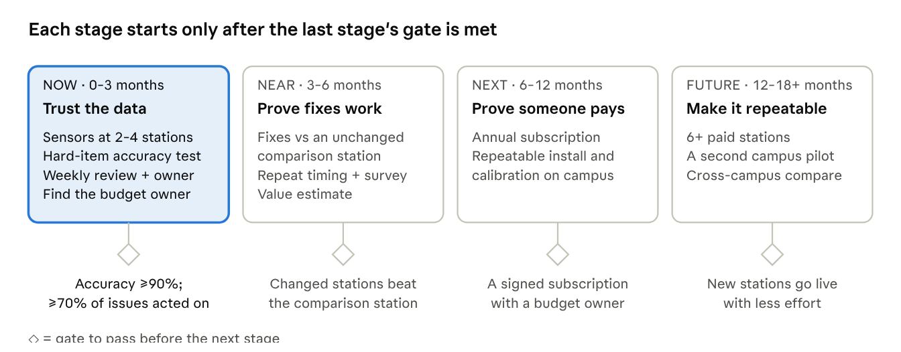

# BinSight — Product Understanding

> Matches the current prototype in `/prototype`.

## The product in one paragraph

BinSight helps a university's recycling team find out **which outdoor bins get contaminated, why, and whether a fix worked**, in weeks instead of waiting for the yearly audit. A small camera module clips inside existing bins and records what goes in, never who. Each week the team gets a station-by-station view, **one recommended fix** with its evidence and an owner, and a fair before-and-after check against a station that was left unchanged. The person throwing waste away does nothing new: no app, no scan, no extra step.

- **Customer and main user:** the campus Materials and Recycling lead (persona: Marcus)
- **First setting:** 2–4 outdoor or open-area stations at Northeastern, starting with the new Big Belly station
- **Business model:** a paid one-semester pilot, then a yearly fee per station
- **Stage:** concept moving to pilot. Nothing is built; outdoor sensing accuracy is untested.

The thesis: *accurate data that nobody acts on is a dashboard, and a dashboard is not a business.*

## The problem

The university can't see where sorting breaks down, so it can't tell which fixes work. Research turned the original idea (an automatic sorting bin) into two connected problems:

1. **Public bins make the wrong choice the easiest one.** People decide in seconds, by habit, and use the nearest bin.
2. **The university learns about contamination too late to act.** It finds out from one audit a year or a rejected load, with no link to a station, item or time.

**What the research showed** (8 interviews, a site walk on Oct 9, 2026, observation):

| Finding | Evidence |
| --- | --- |
| Sorting is a seconds-long habit | Students decide in under 10 seconds to a minute; one put a coffee cup in the trash right next to a recycling bin |
| Placement beats information | A compost bin placed away from the door stayed clean; the trash bin beside it, with detailed signs, held recyclables |
| Nobody owns the public bin | Cafés sort carefully but stop at their counter; custodians fix only what they notice; haulers can't sort |
| The university sees it late | One yearly audit plus weekly hand sorts; problems surface when a load is sent back |
| Signs and tools haven't worked | Signage is mostly ignored; a guidance tool sent a clean paper wrap to the trash in the recycling lead's own test |
| Outdoor bins are the worst | Reported at about 50–60% contaminated (method unconfirmed, so we set our own baseline) |

**Why it costs the university:** Northeastern hasn't paid hauler contamination fees, so the value comes from elsewhere: trash costs more to dispose of than recycling, audits and hand sorts take staff time, and Massachusetts disposal bans carry compliance risk. Campus context: about 4,500 tons of waste in 2022, roughly 21% recycled.

## Who it's for

| Who | Role in the product | What they need |
| --- | --- | --- |
| **Marcus**, campus Materials and Recycling lead | Main user and intended customer | See which stations, items and times drive contamination; try one fix; know within weeks if it worked; show the University Waste Management Office team real progress |
| **Maya**, student or visitor at the bin | Affected user, a design rule | Throw things away in seconds with nothing new to do. She never sees an app, scan or screen |
| **Dev**, operations and logistics lead | Secondary user (Release 2) | Contamination next to the pickup and fill data he already uses |
| **Grounds** (campus grounds / facilities team) | Owns outdoor bins; carries out bin changes | Clear, approved changes with a named owner |
| **Marketing and Communications** | Approves anything visible outdoors | Approves the module and the station notice |
| **Administration and student representatives** | Privacy review | Proof the camera sees only inside the bin |
| **University Waste Management Office team** | Receives the monthly report | A clear monthly picture: what changed, what worked, what can be trusted |

**Marcus's job to be done:** when I only find out about contamination from the annual audit or a rejected load, I want to see which stations, items and times drive it and whether a bin change lowered it, so I can spend limited budget and staff time on fixes that work.

**Open question:** the budget owner is not confirmed. It could be Materials and Recycling or Grounds.

## How BinSight works

A weekly loop: sense what goes into each bin → show where it goes wrong → recommend one fix → make it → prove whether it worked with hand audits → learn for next time.

The loop closes through the learning record: every fix, its runner-up and its verified result become evidence for the next recommendation at a station with a similar pattern.

**The parts**

- **Station module (hardware).** About 16 × 10 × 5 cm and 0.6 kg (estimates). Clips under the lid of an existing bin with no drilling. A downward camera with a privacy shield sees only the bin's interior. An on-device chip identifies each item and gives a confidence score. Stores 7 days of readings if the signal drops; runs on the Big Belly's solar battery or a battery pack.
- **Sensing output (AI).** For each item: a waste type and a confidence score. Readings below the confidence threshold are marked uncertain and never counted as mistakes. A whole bag dumped at once is one mixed-bag event, not many item mistakes. Raw images are deleted within 7 days; only item records leave the module.
- **Two kinds of data.** Sensor counts are continuous and show where to look. Weighed hand audits are the official result. The two are always labelled and never mixed.
- **Weekly view (software).** Marcus's dashboard: station status, problem items and times, one recommended fix, the change log and before-and-after results.
- **Monthly report.** Generated on the 1st of each month and sent to the University Waste Management Office team.
- **People.** Maya disposes of waste as usual. Grounds makes the bin changes. Staff change bags as before. Marcus reviews the view each week and owns the decisions.

## Schedule rules used in the prototype

- Weeks run **Sunday to Saturday**. The weekly view is **updated every Monday** with the week that just ended.
- Hand audits run **monthly on the 1st** (Sep 1 baseline, Oct 1, Nov 1; next one Tue Dec 1).
- **Reports are monthly for now:** one report on the 1st of each month, sent to the **University Waste Management Office team**. No weekly report.
- Prototype "today" is **Mon Nov 23, 2026**; the latest week is **Sun Nov 15 – Sat Nov 21**.

## How it will be implemented

A paid one-semester pilot at 2–4 outdoor or open-area stations, starting with the new Big Belly station, plus one unchanged comparison station. Only the first 3 months are committed; later stages depend on what the pilot shows.

1. **Agree the pilot:** scope, stations, cost compared with current audit spend, and who pays.
2. **Get approvals:** Grounds for the bins, Marketing and Communications for anything visible, and a privacy review with administration and a student representative.
3. **Install and check:** clip modules onto existing bins, run the field-of-view test (camera sees only the bin) and a two-week accuracy test on hard items: a clean paper wrap, a cup with liquid, a bag with trash inside.
4. **Set the baseline:** a weighed hand audit at every station before anything changes.
5. **Run the weekly loop:** review findings, pick one fix per station with a named owner, make it with Grounds, log it.
6. **Measure:** monthly hand audits, compared with the comparison station.
7. **Report:** a monthly report to the University Waste Management Office team; at the end of the pilot it supports the decision to renew or expand.

If the camera fails its accuracy gate, the pilot carries on with hand audits only. If the team still acts on that data, BinSight becomes a measurement service without hardware; if no one acts on it, we stop.

## What the user sees

Marcus works in a weekly web view with 3 areas in the main navigation: **Overview · Change log · Summary**. The install check is a separate tool for installers. Every number is one of two kinds: **sensor** (a count of items, dashed border, a hint about where to look) or **audit** (weighed by hand, solid border, the official result). Missing data shows as **"No data", never 0%**.

**Sample stations**

| Station | Role | Story in the prototype |
| --- | --- | --- |
| A · Curry Student Center | Pilot (Big Belly) | Needs a decision this week |
| B · Snell Library | Pilot | Sign added Sep 16; sensor data quality low; no real change (−2% vs −4%) |
| C · Centennial Walkway | Pilot | Trash bin paired Sep 15; audits 48% → 33% → 31% vs D 45% → 44% → 43% (−35%) |
| D · ISEC Walkway | Comparison (unchanged) | Offline since Wed Nov 18 |

### Main path: from finding to proof

| # | Screen | Question it answers | What Marcus can do |
| --- | --- | --- | --- |
| 1 | Overview | What needs me this week? | Pick a week; open a priority or a station |
| 2 | Station detail | What is going wrong here? | Open the recommended fix |
| 3 | Recommendation | What should I do, and why? | Accept; choose another fix and say why; or mark "can't be done" and see the next option |
| 4 | Change log | Record what I did | Log it. A future date is refused; a second change at a station already being measured shows a warning |
| 5 | Result | Did my fix work? | Add it to the summary; use the same fix elsewhere |
| 6 | Summary (monthly report) | What goes to the University Waste Management Office team this month? | Pick month and year; request cost data; download a PDF |

### When something goes wrong

| Situation | What the product shows | What Marcus can do next |
| --- | --- | --- |
| Sensor unsure about too many items (over 15%) | Hides sensor numbers and gives **no recommendation**; shows the cause (e.g. glare) and the last hand audit | Request a hand check; report the glare problem |
| Station offline | **"No data, not 0%"**; whether data is lost (7 days stored on the module); what still works (audits) | Report the fault |
| A fix didn't help | Verdict "no real change" next to the comparison station; suggests a different type of fix | Add the next fix to the weekly review |
| Sensor and audit disagree | Station marked "not ready to share" and left out of the monthly report | Wait for a recheck; rely on audits |
| Too little audited waste | "No reliable comparison yet", with no verdict | Add audit sessions |

### At the bin

Only a privacy notice: "This bin looks at what goes in. It never records you." Maya has nothing else to read or do.

## How we measure success

The pilot succeeds if audited contamination at changed stations falls **at least 30% below their own baseline** and beats the unchanged comparison station, without pushing recyclables into the trash. All targets stay provisional until the baseline audit is done.

**North Star: Recycling Correct-Sort Rate.** Accepted recyclable weight ÷ total audited recycling weight × 100, from hand audits. Example: 40% contamination must fall to 28% or below.

| Metric | Target | What it tells us |
| --- | --- | --- |
| Recyclables in trash (guardrail) | No increase from baseline | Recycling didn't just get cleaner by sending recyclables to the trash |
| Classification accuracy | ≥90% overall and on hard items; no high-impact item type below 80% | The sensor data is good enough to act on |
| Uncertain readings | ≤15% per week | The sensor isn't guessing too often |
| Issue-to-action rate | ≥70% of flagged problems get a change within 14 days, by month 3 | The team acts on what it sees |
| Intervention success rate | ≥50% of logged changes verified, at least 2 verified | Recommendations lead to real improvement |
| Disposal time (guardrail) | No increase | Nothing new is asked of people at the bin |
| Paid pilot conversion | 1 signed yearly subscription with a named budget owner within 12 months | Someone will pay to keep it |
| Value-to-fee ratio | At least 2 : 1 at the midpoint, reported as a range | The value justifies the price |

**Decision rules:** accuracy fails but the team acts on hand-audit data → pivot to a measurement service without hardware. Fewer than 40% of issues get acted on, even with hand-audit data → stop. No budget owner by month 6 → approach another campus buyer.

## Business model and risks

Every customer starts with a paid one-semester pilot covering installation, audits and the weekly view. After that, a yearly fee per station that includes hardware, maintenance and updates. We keep ownership of the hardware, so there is no large upfront cost. Pricing rests on the disposal-fee gap, audit and handling time, and recovered material, not on contamination fees.

| Risk | Why it matters | How we handle it |
| --- | --- | --- |
| The camera can't read outdoor waste accurately, especially mixed bags | No trusted data means no product | 90% accuracy gate before any sensor data is used; hand audits as the fallback |
| The recommendation picks the wrong fix | Accurate data can still lead to the wrong action (main reviewer feedback) | Show evidence and the runner-up; let Marcus challenge it; log every choice and result |
| No one confirms a budget | No paid conversion | Find the budget owner in the first 3 months; pivot buyer by month 6 |
| A camera in a public space fails privacy review | The pilot is blocked | Field-of-view test before approval; items, not people; images deleted within 7 days |
| The team doesn't act on findings | Visibility without results | One fix per problem with a named owner; issue-to-action rate tracked |

## What the prototype tests

*We are building this prototype to determine whether a campus recycling lead can go from a station-level contamination finding to choosing one fix and judging whether it worked, when the data shows uncertainty and gaps.*

It tests usability, trust, workflow fit and value with real stakeholders. It does **not** test sensing accuracy; that is the pilot's job.

## Open questions

- [ ] Who holds the budget for outdoor stations: Materials and Recycling or Grounds?
- [ ] How long to wait before judging a change (PRD Q-10)?
- [ ] Real module size, weight and power source
- [ ] Should the camera pause automatically during bag changes?
- [ ] What the real baseline contamination rate is at the pilot stations
- [ ] Monthly audits (prototype) vs baseline / mid / end audits (PRD) — which schedule is final?
